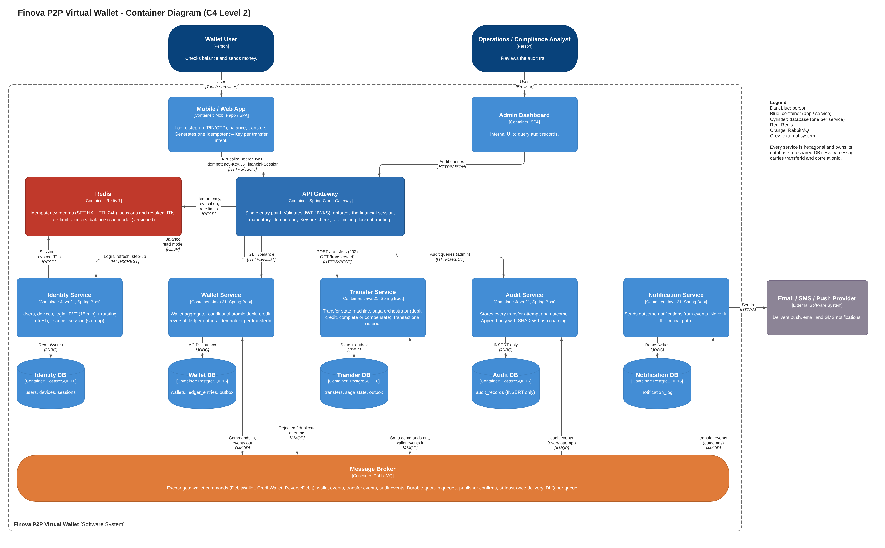

# ARQ2-2026-TS-004 — Finova (P2P Virtual Wallet)

Software Architecture II — Case 4 (Finova). Monorepo for Wave 1 (design and specification) and Wave 2 (implementation) of a P2P wallet that fixes the chained synchronous microservices failure described in the case.

- **Tech Spec (Google Docs):** [TS-004](https://docs.google.com/document/d/1-GJPzH895Ihz2LnYJ5DLhFlYbazJBZAaTLTPJENgFI4/edit)
- **Contract specification:** [`docs/spec.md`](docs/spec.md)
- **ADRs:** [`docs/adrs`](docs/adrs)
- **C4 diagrams:** [`docs/assets`](docs/assets) (`c4-context.png`, `c4-containers.png`, editable source `finova-c4.drawio`)

## Team TS-004

- Alejandro Aguilar García
- Ricardo Amortegui Espinosa
- Juan Esteban Moreno Cuadros
- Juan Camilo Duarte Vasco
- Sebastian García Velez

## Problem (short)

Finova performs chained synchronous HTTP calls (`User-Service -> Wallet-Service -> Notification-Service`):

1. **Money loss on partial failure.** A network micro-cut between "debit sender" and "credit receiver" leaves funds debited but never credited, with no compensation.
2. **Double charging under latency.** Users press *Transfer* several times per second; with no idempotency at the entry point the transfer runs several times and overdraws the account.

## Architecture (summary)



| Container | Technology | Role |
|---|---|---|
| API Gateway | Spring Cloud Gateway | Single entry point: JWT validation, financial session, mandatory `Idempotency-Key` (Redis `SET NX`), rate limiting, routing |
| Identity Service | Java 21, Spring Boot | Login, JWT + rotating refresh, devices, financial session (step-up PIN/OTP) |
| Transfer Service | Java 21, Spring Boot | Transfer state machine, orchestrated saga, transactional outbox |
| Wallet Service | Java 21, Spring Boot | Wallet aggregate, conditional atomic debit, credit, reversal, ledger, balance read model |
| Audit Service | Java 21, Spring Boot | Append-only, hash-chained audit of every attempt |
| Notification Service | Java 21, Spring Boot | Push/email/SMS from outcome events, off the critical path |
| PostgreSQL 16 ×5 | Database per service | `identity_db`, `wallet_db`, `transfer_db`, `audit_db`, `notification_db` |
| RabbitMQ | Message broker | `wallet.commands`, `wallet.events`, `transfer.events`, `audit.events` |
| Redis 7 | Cache / store | Idempotency keys, sessions and revocation, rate limits, balance read model |

## Mandatory features and where they live

| # | Feature | Components | Contract | ADR |
|---|---------|-----------|----------|-----|
| 1 | Robust authentication and financial session | Identity + Gateway + Redis | spec §4.1, §6 F1 | 001 |
| 2 | Fast, high-concurrency balance read | Wallet + Redis read model (CQRS) | spec §4.2, §6 F2 | 004 |
| 3 | Strict idempotency at the Gateway | Gateway + Redis + `UNIQUE(user, key)` in Transfer DB | spec §4.3, §6 F3 | 003 |
| 4 | Saga / Outbox with automatic compensation | Transfer (orchestrator) + Wallet + RabbitMQ + outbox | spec §5, §6 F4 | 002 |
| 5 | Append-only audit of every attempt | Audit Service + `audit.events` + hash chain | spec §4.4, §5.7, §6 F5 | 005 |

## Repository layout

```
/docs
  spec.md                       # REST + async contracts, WHEN/THEN scenarios (Wave 1)
  /adrs                         # Architecture Decision Records (001-006)
  /assets                       # C4 diagrams (PNG) + draw.io source
/services                       # (Wave 2) microservices source
  wallet-service/               # scaffolded (Bancolombia scaffold, hexagonal layout)
/gateway                        # (Wave 2) Spring Cloud Gateway
docker-compose.yml              # (Wave 2) local orchestration
DEVELOPMENT_PLAN.md             # roadmap for Waves 1 and 2
```

## Delivery status

- Wave 1 — Planning, Design, Specification (SDD): **in review**
- Wave 2 — Implementation (monorepo, Docker Compose): **in progress** (wallet-service scaffold)

Professor access: GitHub user `BrandonCadavid` (Read) if the repository is private.
