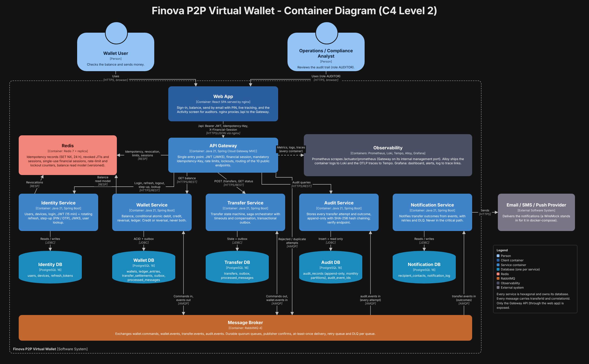

# ARQ2-2026-TS-004 — Finova (P2P Virtual Wallet)

Software Architecture II — Case 4 (Finova).
Monorepo for Wave 1 (design & specification) and Wave 2 (implementation) of a resilient P2P wallet that fixes the chained-synchronous-microservices failure described in the case.

## Quick links

- **Tech Spec (TS-004):** [Open in Google Docs](https://docs.google.com/document/d/1-GJPzH895Ihz2LnYJ5DLhFlYbazJBZAaTLTPJENgFI4/edit?tab=t.0)
- **Contract specification:** [docs/spec.md](docs/spec.md)
- **Architecture Decision Records:** [docs/adrs](docs/adrs)
- **C4 diagrams:** [docs/assets](docs/assets)
- **Observability (finding a request in the logs):** [docs/observability.md](docs/observability.md)
- **Demo runbook (Wave 2):** [Demo](#demo-wave-2)

## Problem (short)

Finova's current architecture performs chained synchronous HTTP calls (User-Service → Wallet-Service → Notification-Service). This produces two critical failures:

1. **Money loss on partial failure.** A network micro-cut between the "debit sender" and "credit receiver" calls leaves funds debited but never credited. No automatic compensation exists.
2. **Double-charging under latency.** Impatient users press *Transfer* several times per second. With no idempotency or state validation at the entry point, the same transfer is executed multiple times, driving accounts into overdraft.

## Target architecture (summary)



- **API Gateway** terminates auth, enforces **Idempotency-Key** on write operations, and rate-limits by user/session.
- **Identity Service** issues 15-minute access tokens, rotating refresh tokens and the single-use financial session (step-up with PIN or OTP) every transfer needs.
- **Wallet Service** is the single source of truth for balances. Writes go through an **Outbox**; reads are served from a **Redis read model** kept in sync by Outbox events (CQRS).
- **Transfer Service** runs a **Saga** (debit → credit → complete) with explicit compensations (reversal) if any step fails or times out.
- **Audit Service** keeps an **append-only, SHA-256 hash-chained record** of every attempt (accepted, rejected, duplicate, debited, credited, compensated, failed), used for audit and reconciliation.
- **Message Broker** (RabbitMQ) carries Saga commands/events and Outbox dispatches; **Notification Service** is a pure consumer.

## Mandatory features (and where they live)

| # | Feature | Component |
|---|---------|-----------|
| 1 | Robust auth & financial-session management | [identity-service](services/identity-service) + [api-gateway](services/api-gateway) (JWT + step-up for transfers) |
| 2 | Fast, high-concurrency balance read | [wallet-service](services/wallet-service) read API backed by a Redis read model (CQRS, synced from the Outbox) |
| 3 | Idempotency for P2P transfers | [api-gateway](services/api-gateway) `Idempotency-Key` store (Redis) + unique constraint in [transfer-service](services/transfer-service) |
| 4 | Saga / Outbox with automatic compensation | [transfer-service](services/transfer-service) + [wallet-service](services/wallet-service) Outbox + RabbitMQ |
| 5 | Immutable append-only audit record | [audit-service](services/audit-service) (insert-only, hash-chained table) |

Transfer outcomes reach the users through [notification-service](services/notification-service), a pure consumer.

## Repository layout

```
/docs
  spec.md                 # OpenAPI / AsyncAPI contracts (Wave 1)
  /adrs                   # Architecture Decision Records
  /assets                 # C4 diagrams (PNG/JPG)
  /postman                # Postman collections: auth, and the whole transfer flow
/services                 # (Wave 2) api-gateway, identity, wallet, transfer, audit and notification services
/infra                    # RabbitMQ topology, observability config, notification provider mock
  /demo                   # scripts for the two failure modes of the case (see Demo)
docker-compose.yml        # (Wave 2) local orchestration
.env.example              # local credentials and ports (copy to .env)
```

## Running locally

```bash
cp .env.example .env

# Infrastructure only: 5 PostgreSQL DBs, Redis (primary + replica), RabbitMQ (topology from spec.md §4.2), Prometheus, Loki, Tempo, Alloy, Grafana
docker compose up -d

# One service plus the infrastructure it depends on
docker compose up -d --build wallet-service

# Whole system: 6 services plus the infrastructure (the first build takes a few minutes)
docker compose --profile apps up -d --build

# Stop everything and start again from the demo data (removes the volumes)
docker compose --profile apps down -v
```

| URL | What |
|-----|------|
| http://localhost:5173 | Web app (`frontend/`): nginx serves it and forwards `/api/*` to the Gateway |
| http://localhost:8080 | API Gateway (the only backend service exposed, spec.md §1.4) |
| http://localhost:15672 | RabbitMQ management |
| http://localhost:9090 | Prometheus |
| http://localhost:3000 | Grafana: Prometheus, Loki and Tempo datasources plus the "Finova - Overview" dashboard |

Tests named `*IntegrationTest` start real containers with Testcontainers, so Docker must be running for `./gradlew build`.

**Testing with Postman.** Two collections in `docs/postman`, both run in order with the Collection Runner; each request stores what the next one needs:

- `finova-auth.postman_collection.json`: login, refresh rotation, step-up, the Gateway checks and logout (Feature 1). Folder 5 locks beto's login for 15 minutes.
- `finova-transfers.postman_collection.json`: the whole transfer flow with the system up (Features 2 to 5); see [Demo](#demo-wave-2).

**Demo users** (seeded by Identity's Flyway migration `V2__demo_users.sql`; registration is out of scope). Password for all: `Finova2026!`

| Email | userId | Roles | PIN | TOTP secret (base32) | Opening balance |
|-------|--------|-------|-----|----------------------|-----------------|
| ana@example.com | `7f3c2b1a-0d4e-4f5a-8b6c-9d0e1f2a3b4c` | USER | 4821 | `JOJYF2MFLYMVTZVHPQXBEZXZPG3BSRZ2` | 500000.00 COP |
| beto@example.com | `2b9d4e6f-1a3c-4e5b-9d7f-0a1b2c3d4e5f` | USER | 1357 | `PKZZTNT77VM46PZFLWFLUYH2A6H4CQIH` | 100000.00 COP |
| auditor@example.com | `5e8a1c3d-7b9f-4d2e-8a6c-1f3b5d7e9a0c` | USER, AUDITOR | 2468 | `3VXYPA2XFSJ24ISKPOYKKEZFJEKVK4SM` | 0.00 COP |

Wallet's `V2__demo_wallets.sql` gives each user one wallet with that balance, recorded as an `OPENING` ledger entry. Add a TOTP secret to any authenticator app (6 digits, 30 s) to use `"method": "OTP"` on `POST /auth/financial-session`. The secrets are stored encrypted with the development key in `OTP_ENCRYPTION_KEY`; these are demo credentials only.

**Finding a request in the logs.** Every response carries an `X-Correlation-Id` header, and the Gateway and the services print that id in their log lines. In Grafana, **Explore** → **Loki**: `{service=~".+"} |= "<X-Correlation-Id>"`. See [docs/observability.md](docs/observability.md), which also explains how to add it to a service.

## Demo (Wave 2)

With the whole system up (`docker compose --profile apps up -d --build`, every container `healthy` in `docker compose ps`). The scripts need only `bash` and `curl` (Git Bash works on Windows).

**1. The happy path and its audit trail.** Run `docs/postman/finova-transfers.postman_collection.json` with the Collection Runner:

- Ana sends 150,000.00 COP to Beto. The transfer is answered `202` and ends `COMPLETED`, and the balance drops by exactly that amount.
- A retry with the same `Idempotency-Key` is replayed (`Idempotent-Replayed: true`). The same key with another amount gets `422`.
- A transfer over the balance ends `REJECTED`, and one to a user without wallet ends `REVERSED`.
- The auditor sees the whole trail, Gateway duplicates included, and `GET /audit/verify` says the hash chain is valid.

**2. Failure mode 2 of the case: the user taps "Transfer" 10 times (F3.3).**

```bash
infra/demo/double-tap.sh
```

The 10 taps arrive at once with the same `Idempotency-Key`: one `202` and nine `409 IDEMPOTENCY_IN_PROGRESS`. One transfer, one debit, and every duplicate in the audit trail. A later tap replays the `202`.

**3. Failure mode 1 of the case: a network micro-cut between the debit and the credit (F4.3).**

```bash
infra/demo/micro-cut.sh
```

While it runs, the broker sends the `CreditWallet` commands to a hold queue instead of Wallet, so they are lost as in a real cut. The transfer goes `PENDING → DEBITED`, the three credit attempts time out (10 s each), and about 30 s later it ends `REVERSED`. Ana's balance is back where it started, with no human intervention. The script restores the route when it ends, even on Ctrl-C.

**4. Where to look while it runs.**

| What | Where |
|------|-------|
| One request across every service | Grafana → Explore → Loki: `{service=~".+"} \|= "<X-Correlation-Id>"` |
| Queues, retries and DLQs | RabbitMQ management, http://localhost:15672 (`finova` / `finova`) |
| Notifications sent | `docker compose exec notification-db psql -U notification -d notification_db -c "SELECT event_type, user_id, channel, status, attempts FROM notification_log"` |
| Ledger of a wallet | `docker compose exec wallet-db psql -U wallet -d wallet_db -c "SELECT type, amount, balance_after, created_at FROM ledger_entries ORDER BY created_at"` |

The scripts and the collection change the balances. To start the demo again from the opening balances: `docker compose --profile apps down -v`, then up again.

## Team

**Team name:** Grupo #4

**Members:**
- Alejandro Aguilar García
- Ricardo Amortegui Espinosa
- Juan Esteban Moreno Cuadros
- Juan Camilo Duarte Vasco
- Sebastián García Vélez

**Access:**
- Tech Spec shared with `brandoncadavid1@gmail.com` (Editor)
- Repository collaborator: GitHub user `BrandonCadavid` (Read)

## Delivery status

- Wave 1 — Planning, Design, Specification (SDD): **submitted**
- Wave 2 — Implementation (monorepo, docker-compose): **implemented**: six services in docker-compose, each with its own CI build and a 90% coverage gate; see [Demo](#demo-wave-2)
