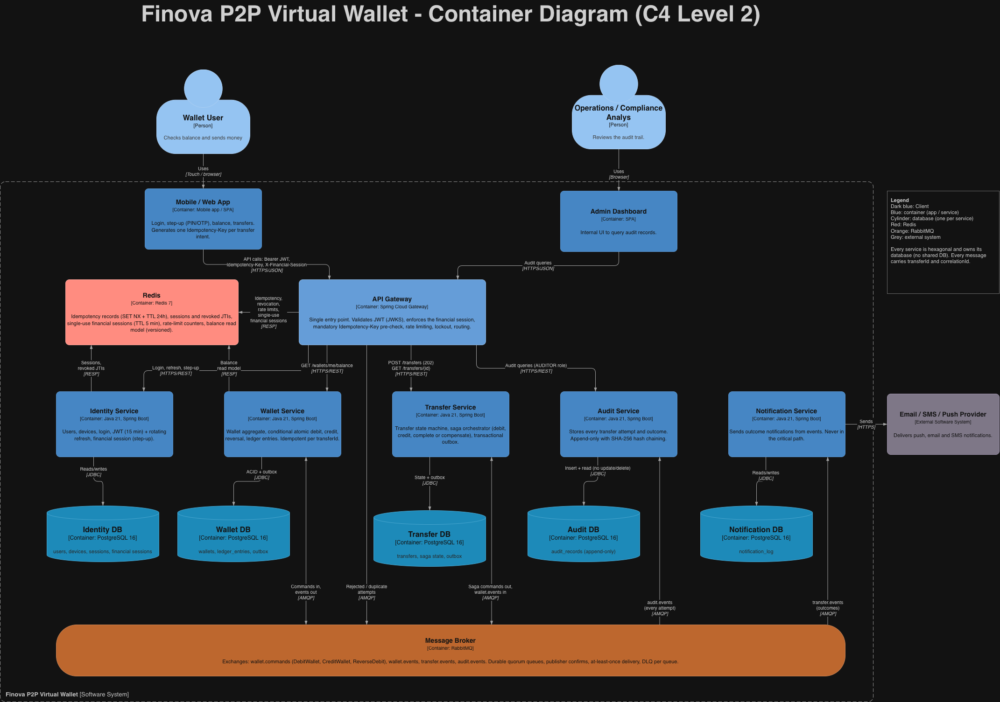

# ARQ2-2026-TS-004 — Finova (P2P Virtual Wallet)

Software Architecture II — Case 4 (Finova).
Monorepo for Wave 1 (design & specification) and Wave 2 (implementation) of a resilient P2P wallet that fixes the chained-synchronous-microservices failure described in the case.

## Quick links

- **Tech Spec (TS-004):** [Open in Google Docs](https://docs.google.com/document/d/1-GJPzH895Ihz2LnYJ5DLhFlYbazJBZAaTLTPJENgFI4/edit?tab=t.0)
- **Contract specification:** [docs/spec.md](docs/spec.md)
- **Architecture Decision Records:** [docs/adrs](docs/adrs)
- **C4 diagrams:** [docs/assets](docs/assets)

## Problem (short)

Finova's current architecture performs chained synchronous HTTP calls (User-Service → Wallet-Service → Notification-Service). This produces two critical failures:

1. **Money loss on partial failure.** A network micro-cut between the "debit sender" and "credit receiver" calls leaves funds debited but never credited. No automatic compensation exists.
2. **Double-charging under latency.** Impatient users press *Transfer* several times per second. With no idempotency or state validation at the entry point, the same transfer is executed multiple times, driving accounts into overdraft.

## Target architecture (summary)



- **API Gateway** terminates auth, enforces **Idempotency-Key** on write operations, and rate-limits by user/session.
- **Auth Service** issues short-lived financial-session JWTs (step-up for transfers above threshold).
- **Wallet Service** is the single source of truth for balances. Writes go through an **Outbox**; reads are served from a **Redis read model** kept in sync by Outbox events (CQRS).
- **Transfer Orchestrator** runs a **Saga** (debit → credit → notify) with explicit compensations (reversal) if any step fails or times out.
- **Ledger Service** keeps an **append-only immutable journal** of every attempt (requested, authorized, debited, credited, compensated, failed), used for audit and reconciliation.
- **Message Broker** (RabbitMQ) carries Saga commands/events and Outbox dispatches; **Notification Service** is a pure consumer.

## Mandatory features (and where they live)

| # | Feature | Component |
|---|---------|-----------|
| 1 | Robust auth & financial-session management | Auth Service + Gateway (JWT + step-up for transfers) |
| 2 | Fast, high-concurrency balance read | Wallet Service read API backed by a Redis read model (CQRS, synced from Outbox) |
| 3 | Idempotency for P2P transfers | API Gateway `Idempotency-Key` store (Redis) + DB unique constraint |
| 4 | Saga / Outbox with automatic compensation | Transfer Orchestrator + Wallet Outbox + RabbitMQ |
| 5 | Immutable append-only audit record | Ledger Service (append-only table / event log) |

## Repository layout

```
/docs
  spec.md                 # OpenAPI / AsyncAPI contracts (Wave 1)
  /adrs                   # Architecture Decision Records
  /assets                 # C4 diagrams (PNG/JPG)
/services                 # (Wave 2) microservices source
/gateway                  # (Wave 2) API Gateway
docker-compose.yml        # (Wave 2) local orchestration
DEVELOPMENT_PLAN.md       # roadmap for Waves 1 and 2
```

## Team

**Team name:** Grupo #4

**Members:**
- Alejandro Aguilar García
- Ricardo Amortegui Espinosa
- Juan Esteban Moreno Cuadros
- Juan Camilo Duarte Vasco
- Sebastián García Vélez

**Access:**
- Tech Spec shared with `brandoncadavid1@gmail.com` (Editor)
- Repository collaborator: GitHub user `BrandonCadavid` (Read)

## Delivery status

- Wave 1 — Planning, Design, Specification (SDD): **submitted**
- Wave 2 — Implementation (monorepo, docker-compose): **pending**
